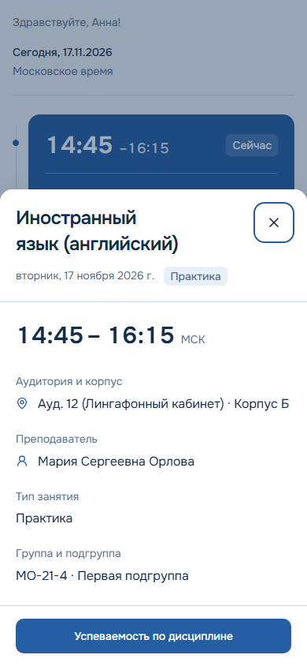

# Интерфейс v4 «Маршрут дня» и Блик

Утверждённый вариант B «Маршрут дня» связывает собственный знак из линии и узлов с временной линией расписания. В карточке первыми считываются время, предмет и аудитория. Шрифт Onest и основной синий `#245FA6` используются в обеих темах. Светлая палитра включает фон `#F0F5FC`, поверхность `#FFFFFF` и текст `#142D4A`. В тёмной теме фон `#101319`, поверхность `#1B222D`, светлый текст и прежний светлый оттенок `#C8D8ED` для ссылок. Это самостоятельный конкурсный концепт без официальной символики вуза.

Базовые правила и образцы описаны в [DESIGN.md](../DESIGN.md) и [design.json](../.impeccable/design.json). Действующие цветовые роли обеих тем определены в [globals.css](../src/app/globals.css). Сторонние материалы перечислены в [реестре](third-party.md).

## Что перенесено

| Область             | Реальное состояние                                                                                                                                     |
| ------------------- | ------------------------------------------------------------------------------------------------------------------------------------------------------ |
| Вход и профиль      | Существующая Better Auth-сессия и профиль; обновлены композиция и общие компоненты.                                                                    |
| Расписание          | День, компактная неделя, изменения, выбор даты, контекст недели и прогресс текущей пары на существующих запросах.                                      |
| Подробности занятия | Общая панель на главной и в расписании; прямой маршрут сохранён.                                                                                       |
| Успеваемость        | Семестры, дисциплины, учебная сводка и сессия подключены к существующим серверным выборкам; заполненные данные доступны в v4.                          |
| Главная             | Персональное приветствие, дата и живые часы, занятия дня и агрегат P6: учебная сводка, ближайший экзамен, активные заявки и непрочитанные уведомления. |
| Заявки              | Студенческие список, каталог, создание, карточка с историей и отмена; сохранён кабинет сотрудника v4 с очередью и сменой статуса.                      |
| Уведомления         | Лента, фильтры, загрузка следующих элементов и отметки прочтения на готовых серверных действиях.                                                       |
| Блик                | Правая карточка на широкой главной, вход из навигации и мобильной шапки, единая панель чата на штатном `/api/ai/chat`.                                 |

Темы «Авто», «Светлая» и «Тёмная» выбираются через значок солнца/луны до входа и в кабинете. Автоматический режим следует системе, ручной выбор сохраняется между посещениями. Общие радиусы, границы, тени и состояния фокуса согласованы для карточек, формы и панели. Подсветка завершённой пары имеет скругление 16 px.

Прогресс показывается только во время текущего занятия на главной, в дне и неделе. Нативный `<progress>` отражает прошедшую часть фактического интервала, в том числе после переноса. Подпись сообщает прошедшие минуты, значение обновляется каждые 15 секунд и при возвращении в окно. Для будущих, завершённых, отменённых и некорректных интервалов шкала скрыта.

На широком экране расписание занимает доступную ширину до 1600 px и центрируется. На 1910 px правое поле уменьшилось с 482 до 44 px. На 2560 px внутренние поля рабочей области равны 320 px. Названия дисциплин ограничены читаемой строкой 60ch, длинные названия переносятся.

Нажатие или Enter на занятии открывает подробности поверх текущего экрана и сохраняет URL, историю, прокрутку и выбор расписания. От 768 px панель шириной 576 px входит справа. На мобильном она входит снизу и занимает до 92dvh. Переход длится 200 мс, при уменьшенном движении панель открывается сразу. Закрыть её можно кнопкой, Escape и нажатием на затемнение. Прокручивается содержимое панели. Фокус остаётся внутри и после закрытия возвращается к занятию. Для прямого открытия используется адрес занятия.

Данные панели собираются из авторизованных серверных контрактов. Внешний контейнер панели использует `overflow: clip`, чтобы начальный фокус сохранял положение панели во время перехода.

## Блик и панель помощника

Блик — тёплая звезда с геометрией и цветами из предоставленного `blik.json`. На десктопе помощник открывается в немодальной панели справа. На телефоне рабочая область располагается над нижней навигацией. История чата доступна из всех входов в текущей вкладке.

При открытии Блик приветствует пользователя. Во время моргания корпус неподвижен. Рядом с персонажем взгляд следует за указателем. Короткие жесты соответствуют ожиданию, получению ответа, успеху и ошибке. При `prefers-reduced-motion` персонаж статичен.

Панель использует `POST /api/ai/chat`. Флаг `AI_ASSISTANT_ENABLED` управляет доступностью входа в чат. Для ответов модели нужен серверный ключ провайдера. При включённом чате и отсутствующем ключе панель показывает сообщение о недоступности. Помощник читает данные текущего студента. [Настройка запуска](../README.md).

## Где продолжать работу

| Артефакт              | Файлы реализации                                                                                                                                    |
| --------------------- | --------------------------------------------------------------------------------------------------------------------------------------------------- |
| Цвета, шрифт, токены  | [`src/app/globals.css`](../src/app/globals.css), [`src/app/layout.tsx`](../src/app/layout.tsx), [`public/fonts/onest/`](../public/fonts/onest/)     |
| Оболочка и компоненты | [`src/components/layout/app-shell.tsx`](../src/components/layout/app-shell.tsx), [`src/components/ui/`](../src/components/ui/)                      |
| День и неделя         | [`src/app/(app)/schedule/page.tsx`](../src/app/%28app%29/schedule/page.tsx), [`src/components/schedule/`](../src/components/schedule/)              |
| Панель и DTO          | [`lesson-details-provider.tsx`](../src/components/schedule/lesson-details-provider.tsx), [`schedule-details.ts`](../src/lib/ui/schedule-details.ts) |
| Главная               | [`src/app/(app)/page.tsx`](../src/app/%28app%29/page.tsx), [`src/components/dashboard/`](../src/components/dashboard/)                              |
| Успеваемость          | [`src/app/(app)/grades/page.tsx`](../src/app/%28app%29/grades/page.tsx), [`src/components/grades/`](../src/components/grades/)                      |

## Примеры предыдущей итерации

Снимки показывают предыдущую итерацию от 17.11.2026 на вымышленных данных в сборке `Zmg4VZsJtJfDQrewEnWGr`. В тёмном расписании часы браузера установлены на 09:45 для показа шкалы. Прошло 45 из 90 минут.

## Проверка предыдущей итерации и границы v4

Для предыдущей сборки `Zmg4VZsJtJfDQrewEnWGr` в Chromium прошли 48 проверок расписания, 41 главной, 78 темы, прогресса и часов, 26 широкой сетки и 8 дополнительных сценариев. Отдельно измерены 12 переходов. Проверены обе темы, системный и сохранённый выбор темы, первое отображение, открытие и закрытие панелей, фокус и сохранение контекста. Для шкалы и границы дня использовались управляемые часы браузера.

Сборка, TypeScript, ESLint и форматирование 49 изменённых файлов прошли. Финальный Impeccable scan этих файлов вернул 0 замечаний. В 52 записях axe нарушений нет. Незавершённые автоматические правила дополнены ручной проверкой фокуса и устоявшегося контраста. Проверено по 179 вычисленных сочетаний текста и фона в каждой теме, минимальные значения 4.512:1 и 5.981:1.

Команды полного frontend-гейта и его статус описаны в [плане](DEVELOPMENT_PLAN.md). Полный frontend-гейт остаётся открытым. `test`, `test:e2e` и полный `gate` в этой работе не запускались. CI полного гейта ожидается после PR в `main`, push в feature-ветку его не запускает.

Проверка крупного текста удваивала вычисленные размеры шрифта и межстрочного интервала. Reduced motion и forced colors проверялись через эмуляцию Chromium.

В объединённом v4 прошли сборка, Prisma validate, TypeScript, ESLint и Prettier. Для Блика в Chromium проверены реальный HTTP `503` на стенде без ключа провайдера и управляемый поток ответа; подменяется только внешняя модель, инструменты и доступ к данным покрыты интеграционными тестами на PostgreSQL. В локальной копии v4 на Windows прошли все 393 теста Vitest и 47 тестов Playwright на отдельной базе. Сквозная приёмка ядра остаётся открытой; запрос с реальной моделью выполнен 22.11.2026: OpenRouter `deepseek/deepseek-v4.1-flash` отвечает через панель и вызывает `getSchedule`. [План разработки](DEVELOPMENT_PLAN.md).
