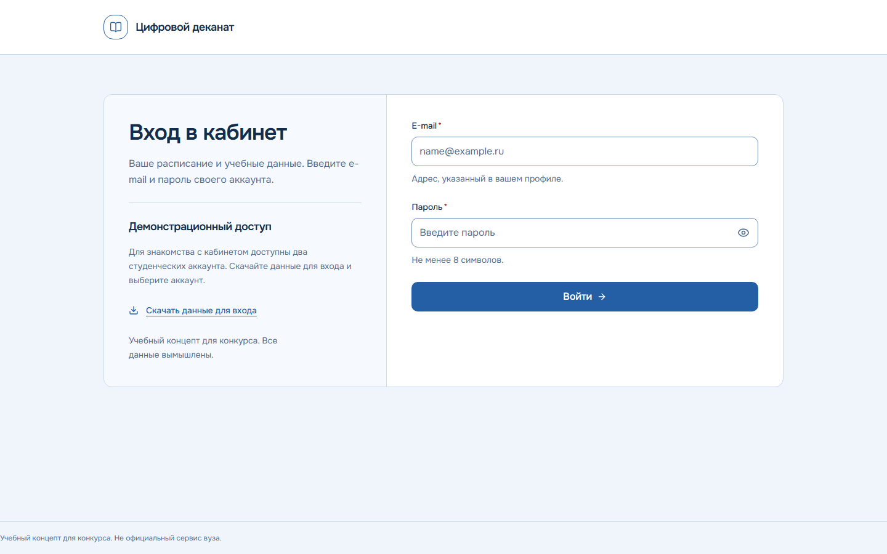
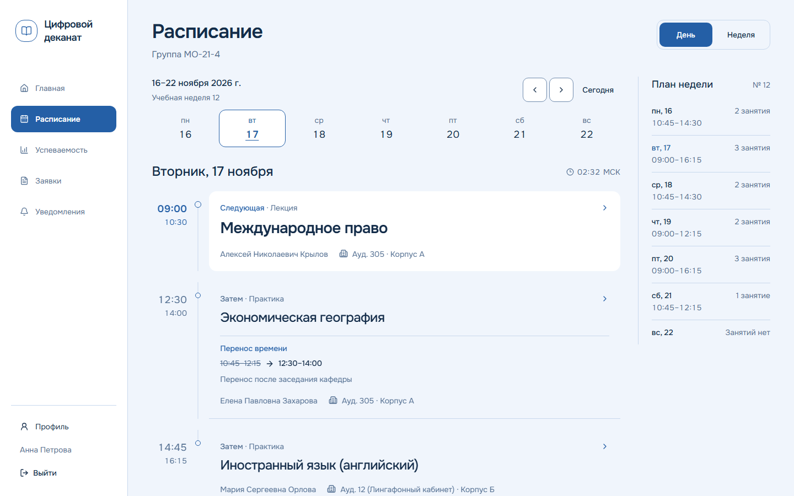

# Интерфейс ветки feat/frontend-design

Утверждённый вариант B «Маршрут дня» сохраняет ясную последовательность учебного дня: время, занятие, заметное изменение и подробности рядом с выбранной строкой. Палитра: основной `#245FA6`, фон `#F0F5FC`, поверхность `#FFFFFF`, текст `#142D4A`. Это самостоятельный конкурсный концепт, без официальной символики вуза.

[DESIGN.md](../DESIGN.md) содержит нормативные токены и правила; [design.json](../.impeccable/design.json) — дополнительные параметры и десять самостоятельных HTML/CSS-образцов. Образцы иллюстративны и не подменяют серверные данные. Сторонние материалы перечислены в [реестре](third-party.md).

## Что перенесено

| Область              | Реальное состояние                                                                                                                                                                                                |
| -------------------- | ----------------------------------------------------------------------------------------------------------------------------------------------------------------------------------------------------------------- |
| Вход и профиль       | Существующая Better Auth-сессия и профиль; обновлены композиция и общие компоненты.                                                                                                                               |
| Расписание           | День, компактная неделя, изменения, выбор даты и контекст недели на существующих запросах.                                                                                                                        |
| Подробности занятия  | Общая панель на главной и в расписании; прямой маршрут сохранён.                                                                                                                                                  |
| Успеваемость         | Read-only UI семестров, дисциплин, сводки и сессии подключён к готовому backend P3. Наполненный UI ещё требует проверки в этой среде: использованная dev-база содержит старые пустые оценки и не перезаполнялась. |
| Главная              | Реальные занятия дня и учебный профиль; полного агрегата P6 нет.                                                                                                                                                  |
| Заявки и уведомления | Объяснение недоступности и доступная навигация; backend P4/P5 отсутствует.                                                                                                                                        |

Обычный click/Enter на занятии открывает панель на текущем экране, сохраняя URL, историю и прокрутку; в расписании также выбранные день, неделю и режим. От 768 px панель входит справа, ширина 576 px; на мобильном — снизу, максимум 92dvh. Переход 200 ms, при reduced motion панель статична. Закрытие доступно кнопкой, Escape и затемнением. Фон заблокирован, прокручивается внутреннее содержимое, фокус входит в панель, удерживается в ней и возвращается к триггеру. Модифицированный клик и прямая загрузка используют canonical href.

DTO строится из уже авторизованных серверных контрактов. Внешний viewport панели использует `overflow: clip`: установка начального фокуса не должна прокруткой компенсировать её CSS translate. Backend и контракты данных для этого не менялись.

## Где продолжать работу

| Артефакт              | Файлы реализации                                                                                                                                    |
| --------------------- | --------------------------------------------------------------------------------------------------------------------------------------------------- |
| Цвета, шрифт, токены  | [`src/app/globals.css`](../src/app/globals.css), [`src/app/layout.tsx`](../src/app/layout.tsx), [`public/fonts/onest/`](../public/fonts/onest/)     |
| Оболочка и компоненты | [`src/components/layout/app-shell.tsx`](../src/components/layout/app-shell.tsx), [`src/components/ui/`](../src/components/ui/)                      |
| День и неделя         | [`src/app/(app)/schedule/page.tsx`](../src/app/%28app%29/schedule/page.tsx), [`src/components/schedule/`](../src/components/schedule/)              |
| Панель и DTO          | [`lesson-details-provider.tsx`](../src/components/schedule/lesson-details-provider.tsx), [`schedule-details.ts`](../src/lib/ui/schedule-details.ts) |
| Главная               | [`src/app/(app)/page.tsx`](../src/app/%28app%29/page.tsx), [`src/components/dashboard/`](../src/components/dashboard/)                              |
| Успеваемость          | [`src/app/(app)/grades/page.tsx`](../src/app/%28app%29/grades/page.tsx), [`src/components/grades/`](../src/components/grades/)                      |

## Примеры настоящего приложения

Снимки сделаны 17.11.2026 на вымышленных демонстрационных данных до сборки release-копии. Вход и день — финальная итерация B2; мобильная панель на главной — последующее исправление. Это визуальные примеры, а не доказательство свежего release-прогона.

## Проверка и оставшиеся границы

Предыдущая локальная production-сборка проверена в Chromium на 360/390/768/1440 px. Для исправления панели сохранены 41 PASS / 0 FAIL на главной и 12 измеренных сценариев движения. Сырой регрессионный отчёт остаётся 47 PASS / 1 FAIL: единственное измерение CSS 200% было сделано до конца реальной анимации; точечная проверка той же сборки после её завершения прошла. CSS-увеличение текста не является настоящим browser zoom. Эти результаты и независимое review относятся к прежней сборке.

Проверки новой release-копии фиксируются отдельно в [журнале](ai-log.md); локальная подготовка ветки не закрывает frontend-задачи и гейты [плана](DEVELOPMENT_PLAN.md). `test`, `test:e2e` и полный `gate` в этой работе не запускались. Свежий CI полного гейта ожидается после PR в `main`; push в feature-ветку его не запускает.

Остаются populated UI успеваемости, полный P6, backend P4/P5 и известная backend-граница `BE001` при переносе занятия через неделю. Деплой, физические устройства, виртуальная клавиатура, скринридер, настоящий browser zoom, cross-browser и полная проверка безопасности не выполнены.
