# Как создавался «Цифровой деканат будущего»: процесс работы с ИИ

## 1. Назначение и статус документа

Это описание процесса работы для конкурсного пакета. Оно собирает факты из [`docs/ai-log.md`](../ai-log.md): инструменты, промпты, ошибки, решения, проверки и метрики. Текст готов к экспорту в PDF; скриншоты лежат рядом, в [`screenshots/`](screenshots/).

| Поле             | Значение                                                                                                                          |
| ---------------- | --------------------------------------------------------------------------------------------------------------------------------- |
| Статус документа | Готов к экспорту в PDF (Markdown + PNG)                                                                                           |
| Дата состояния   | 22.11.2026                                                                                                                        |
| Статус проекта   | Ядро реализовано и проверено локально: пять разделов, кабинет сотрудника, ИИ-панель. Публичная ссылка не размещена — нет хостинга |
| Принцип          | Ни один пункт не называется готовым, если он не проверен запуском                                                                 |

Честность здесь не оговорка, а условие: жюри сравнивает текст с продуктом. Поэтому в документе есть и неудачные итерации, и места, которые остались открытыми.

## 2. Проблема студента и выбранные разделы

Студент узнаёт о расписании, оценках и справках из чатов, объявлений и разговоров. Итог — переносы, о которых он узнаёт по факту, задолженности, обнаруженные в конце семестра, и справки, за которыми нужно идти в деканат лично.

Прототип проверяет гипотезу: пять связанных разделов в одном кабинете снимают большую часть этой неопределённости без звонков и очередей.

| Модуль             | Почему выбран                                                    | Требования               |
| ------------------ | ---------------------------------------------------------------- | ------------------------ |
| Главный экран      | Точка входа: что сегодня и что требует внимания                  | `Ф-00`, `US-01`          |
| Вход и профиль     | Без проверенной личности нет приватности данных                  | `Ф-01`, `US-01`, `US-10` |
| Расписание         | Самая частая потребность и самая болезненная — изменения         | `Ф-02`, `US-02`, `US-03` |
| Успеваемость       | Отвечает на вопрос «как у меня дела», а не только «какие оценки» | `Ф-03`, `US-04`, `US-05` |
| Заявки и справки   | Заменяет поход в деканат и снимает неопределённость статуса      | `Ф-04`, `US-06`–`US-08`  |
| Уведомления        | Закрывает контур: изменение видно там, где студент его ждёт      | `Ф-05`, `US-09`          |
| Кабинет сотрудника | Очередь заявок, смена статуса и комментарий                      | `Ф-04.9`, `US-11`        |
| ИИ-помощник        | Вопросы по своим данным без ручного поиска                       | `Ф-06`, `US-12`          |

ИИ-помощник работает только на чтение, не блокирует основные сценарии и включается флагом `AI_ASSISTANT_ENABLED`. Инструменты записи и создание заявки через модель остаются намеренно не реализованными: изменение данных — только обычным действием после подтверждения человеком.

## 3. Инструменты и модели

| Инструмент         | Роль                                                                                                         | Модель                                             |
| ------------------ | ------------------------------------------------------------------------------------------------------------ | -------------------------------------------------- |
| OpenCode           | Агентная среда: чтение репозитория, код, тесты, документы, git                                               | `DeepSeek V4.1 Flash 1017` — реализация и тесты    |
| Субагенты OpenCode | 78 запусков: 30 × `explore` (только чтение), 33 × код, тесты, интеграция и независимый аудит, 15 × документы | Та же среда; отдельные модели не задавались        |
| Codex              | Документационные задачи и независимая проверка изменений                                                     | `GPT-6 Astra` — документация и пакет доказательств |
| OpenCode (приёмка) | Финальная локальная приёмка v4                                                                               | `GPT-6.2 Sol`                                      |
| Git и GitHub       | Ветки по задачам, Conventional Commits, CI                                                                   | —                                                  |

Модель указана по этапу: `DeepSeek V4.1 Flash 1017` в OpenCode — реализация и тесты, `GPT-6 Astra` в Codex — документация и пакет доказательств, `GPT-6.2 Sol` — независимая приёмка.

## 4. Документы для агентов и зачем каждый

| Документ                                               | Что фиксирует                                                      | Зачем агенту                                               |
| ------------------------------------------------------ | ------------------------------------------------------------------ | ---------------------------------------------------------- |
| [`AGENTS.md`](../../AGENTS.md)                         | Инженерные ограничения, безопасность, проверки, Definition of Done | Отвечает на «как работать» и что запрещено                 |
| [`docs/PRD.md`](../PRD.md)                             | Продуктовое поведение: `Ф-XX`, `US-XX`, `A-XX`                     | Отвечает на «что делать»; агент не придумывает функции     |
| [`docs/DEVELOPMENT_PLAN.md`](../DEVELOPMENT_PLAN.md)   | Этапы, задачи, зависимости, статусы, гейты                         | Единственный источник статуса; запрет `[x]` без проверок   |
| [`docs/specs/`](../specs/)                             | Контракты фич: сущности, Zod, действия, состояния, приёмка         | Не начинать поведение без спецификации и открытых вопросов |
| [`docs/TRACEABILITY.md`](../TRACEABILITY.md)           | Связь требования, спецификации, задачи, кода и теста               | Доказательство покрытия, а не второй план                  |
| `docs/adr/`                                            | Принятые и предложенные решения с обоснованием                     | Не пересматривать закрытые вопросы заново                  |
| [`docs/ai-log.md`](../ai-log.md)                       | Хронология, промпты, ошибки                                        | Память процесса между сессиями                             |
| [`docs/process/ai-errors.md`](../process/ai-errors.md) | Разбор ошибок ИИ: симптом, причина, исправление, защита от повтора | Не повторять уже исправленные ошибки                       |
| [`docs/third-party.md`](../third-party.md)             | Лицензии сторонних компонентов                                     | Не подключать непроверенное                                |

## 5. Цикл работы и шаблон брифа

```text
постановка (ID задачи + Ф-XX/US-XX)
   → контекст (PRD → AGENTS.md → план → ADR)
   → спецификация (docs/specs, контракт и открытые вопросы)
   → границы и критерии готовности
   → реализация минимального вертикального среза
   → проверки § 6 AGENTS.md
   → фиксация ошибок (причина → исправление)
   → документация (план, журнал, ADR, трассировка)
   → коммит
```

Три правила держали процесс управляемым:

- **Контракт важнее порядка.** Этапы — контрольные точки, а не очередь: после фиксации схемы расписание, успеваемость и заявки велись одновременно.
- **Один агент — один поток.** Пересечение по файлам исключалось до начала работы, а не разрешалось конфликтом.
- **Документация в том же коммите.** Иначе статусы расходятся между README, планом и журналом — такое расхождение найдено 16.11.2026 и внесено в список ошибок.

Шаблон брифа:

```text
Роль · контекст (что прочитать) · задача (ID плана) · границы (какие файлы)
· что не трогать · критерии готовности · проверки · формат отчёта
```

Примеры: `P2-BE-03` ставилась с запретом «не трогай `P2-BE-02`, её делает другой разработчик»; `P3-BE-01` — с требованием «не дублируй `Discipline`, подготовь миграцию, индексы и ADR»; аудит 16.11.2026 — тремя брифами только на чтение. Полный пример брифа в [`docs/ai-log.md`](../ai-log.md) помечен как реконструированный: он собран по принятым решениям и ADR 0003, но не является дословной цитатой. Пометка принципиальна: выдать сочинённый текст за исторический значило бы подменить доказательство.

## 6. Ключевые промпты по этапам

Ниже — дословные фрагменты постановок, сохранённые в журнале. Полные тексты не публикуются: в таблице — цитата, в журнале — контекст и результат.

| Дата  | Этап, задача       | Дословный фрагмент промпта                                                                                                     | Результат                                                      |
| ----- | ------------------ | ------------------------------------------------------------------------------------------------------------------------------ | -------------------------------------------------------------- |
| 11.11 | PRD и правила      | «Разобрать ТЗ и PDF со стеком, зафиксировать требования и ограничения»                                                         | `docs/PRD.md`, `AGENTS.md`                                     |
| 14.11 | `P2-BE-03`         | «Карточка занятия и изменения; не трогать `P2-BE-02`»                                                                          | Чистый резолвер, 11 unit- и 9 integration-сценариев            |
| 16.11 | `P3-BE-02`         | «Сделать `P3-BE-02`: семестры и оценки только текущего студента, сессия группы, тесты изоляции»                                | `grades.ts`, 9 интеграционных сценариев, 105 тестов            |
| 17.11 | CI и документы     | «Добавить GitHub Actions CI и обновить README, план, трассировку, журнал»                                                      | `.github/workflows/ci.yml`, синхронизация документов           |
| 18.11 | Аудит ТЗ           | «Оценить, меняет ли `HackTask.md` объём ИИ-трека; без рисков дать вердикт по плану; затем обновить план и контракт для фронта» | Решение о read-only объёме `Ф-06`, ADR 0005                    |
| 21.11 | `V4-FE-FINISH-001` | «разрешаю тебе доработать , и выполнить 4 задачи и 4 гейта»                                                                    | Закрыты `P2-FE-02`, `P3-GATE-02`, `P4-FE-02/04/05`, `P5-FE-03` |
| 22.11 | Приёмка P0/P1      | «Починить error boundaries… обновить документ для жюри… подготовить скриншоты»                                                 | Исправлен повтор, 14 скриншотов, этот документ                 |

## 7. Ошибки ИИ и исправления

Ошибки не скрывались: каждая попадала в запись этапа и в сводную таблицу. Полный разбор 27 случаев — в [`docs/process/ai-errors.md`](../process/ai-errors.md): симптом, корневая причина, исправление и проверка, которая ловит повтор. Пять показательных случаев:

| Симптом                                                  | Причина                                                 | Исправление                                               | Вывод                                                                        |
| -------------------------------------------------------- | ------------------------------------------------------- | --------------------------------------------------------- | ---------------------------------------------------------------------------- |
| Playwright не запускался: `import.meta.url` недоступен   | Конфигурация загружалась как CommonJS                   | Пути через `process.cwd()`                                | Среда исполнения — часть контракта; проверять до написания тестов            |
| Кастомные фикстуры «неизвестные параметры»               | Спецификации импортировали `test` из `@playwright/test` | Импорт из `./fixtures`                                    | Один источник `test`, иначе фикстуры не применяются                          |
| Поле пароля не находилось по точной подписи              | `*` обязательного поля входит в доступное имя           | Поиск по роли и префиксу `/^Пароль/`                      | Тест на доступное имя должен повторять реальную разметку                     |
| `getByRole("alert")` ловил не ту ошибку                  | Next.js добавляет свой `role="alert"` (route announcer) | Фильтр по тексту сообщения                                | Проверять не только наличие роли, но и содержание                            |
| Занятие, перенесённое на другой день, исчезало из недели | Выборка шла только по исходному `startsAt`              | Условие по `newStartsAt` и фильтр по фактическому времени | Перенос — это данные, а не оформление; фильтровать после наложения изменений |

**Неудачная итерация, найденная на финальной приёмке.** Ошибка чтения в расписании и заявках не исчезала после кнопки «Повторить»: обработчик вызывал только `reset()`, а тот перерисовывал сегмент из уже закэшированного RSC-ответа. Серверный лог подтвердил, что повторный запрос уходил, но интерфейс возвращался к той же ошибке. Исправление: общий хук `useErrorRetry` вызывает `router.refresh()` и `reset()` в одном `startTransition`, то есть и перезапрашивает данные, и сбрасывает границу ошибки. После пересборки ручная проверка повторилась: искусственная ошибка → «Повторить» → «Probe recovered». Заодно пропсы приведены к реальному контракту Next.js `{ error, reset }`, а юнит-тест перестал маскировать расхождение: он рендерит компонент через `React.createElement` с настоящими пропсами.

**Вторая неудачная итерация.** Нативная клавиатура на Android выявила обрезанную отправку и недоступную нижнюю навигацию. Поле и кнопку разместили на одной строке над клавиатурой, сообщение об ошибке перенесли в прокручиваемую историю, закрытие панели — на момент перехода по ссылке. Отдельно: неверное ожидание общего 404 в тесте заменили проверкой штатного «Занятие не найдено» — тест не должен требовать поведения, которого продукт не обещает.

**Третья неудачная итерация, найденная на приёмке вложенных адресов.** Прямой адрес чужой заявки и несуществующего занятия отдавал HTTP `200` с экраном «не найдено»: `loading.tsx` у страницы деталей начинал стримить оболочку раньше, чем выполнялся `notFound()`, и заголовок ответа уже нельзя было изменить. Исправление двойное: `loading.tsx` у деталей удалены, а проверка доступа перенесена в `generateMetadata`, который резолвится до стриминга; повторное чтение в странице схлопывается через `React.cache`, поэтому запрос к БД остаётся один. Скелетоны списков сохранены через route groups (`requests/(queue)`, `schedule/(list)`). Проверка добавлена в E2E: свой request-ID и своё занятие — `200`, чужой и отсутствующий — `404`, включая вложенные адреса.

## 8. ИИ для контента и дизайна

- **Демо-данные.** 7 преподавателей, 10 дисциплин, 2 корпуса, 6 аудиторий, 29 занятий на текущую неделю и 9 изменений по всем пяти типам; два семестра, 18 оценок, 17 экзаменов и зачётов, 6 заявок, 27 уведомлений. Всё вымышлено; реалистичность (типы занятий, аудитории, причины переносов) проверял человек по `Ф-02`. Seed идемпотентен и запускается повторно без дублей.
- **Тексты интерфейса.** Заголовки, пояснения, подписи статусов и изменений, нейтральные сообщения об ошибках входа. Редактировались вручную: коротко, без канцелярита и внутренних кодов.
- **Пустые состояния и ошибки.** Для каждого ядрового раздела — загрузка, пустота, ошибка с повтором и успех: `loading.tsx`, `error.tsx`, общие `EmptyState`/`ErrorState`. Это требование `A-09`, а не украшение.
- **Дизайн-токены.** Палитра в `oklch`, отступы, радиусы и типографика зафиксированы токенами Tailwind CSS v4; отдельно заданы насыщенные варианты цветов для текста на светлых подложках с расчётом на контраст WCAG AA. Формальная проверка контраста через axe/Lighthouse остаётся открытой (`P7-QA-*`). Варианты предлагал агент, решение принимал человек.
- **Изображения.** Генеративные инструменты (Figma AI, Midjourney, DALL·E и подобные) не использовались. В репозитории 3 PNG предыдущей итерации дизайна и 14 скриншотов текущего интерфейса. Собственный шрифт — Onest 5.3.1 (SIL OFL 1.1), хранится локально.

## 9. Что сделано ИИ и что человеком

| Человек                                      | ИИ (OpenCode)                                     |
| -------------------------------------------- | ------------------------------------------------- |
| Постановка задач и границ, выбор приоритетов | Код серверного слоя, схемы Prisma, миграции       |
| Продуктовые решения и сверка с PRD           | Тесты Vitest и Playwright, фикстуры, конфигурация |
| Приёмка результата, проверка фактов и чисел  | Документация: PRD-черновики, план, ADR, журнал    |
| Решение об отклонённых вариантах             | Seed-данные и тексты интерфейса                   |
| Ручная проверка сценариев и скриншоты        | Разбор ошибок и подготовка исправлений            |

ИИ не принимал решений о приватности, доступе и продуктовом поведении: такие пункты фиксировались человеком в PRD и `AGENTS.md` до кода.

## 10. Безопасность простыми словами

**Что работает.**

- Вход и сессии — Better Auth; в базе хранится только scrypt-хеш пароля, открытого текста нет. Публичная регистрация закрыта: `POST /api/auth/sign-up/email` отвечает `EMAIL_PASSWORD_SIGN_UP_DISABLED`, демо-аккаунты создаёт только seed.
- Сессия проверяется на сервере при каждом защищённом запросе; профиль, оценки, заявки и уведомления читаются по `userId` из проверенной сессии, а не из параметра запроса. Чужой ресурс возвращает нейтральное «не найдено», не раскрывая существование объекта.
- RBAC: роль хранится на сервере; студент не видит очередь сотрудника и не выполняет действия сотрудника. Матрица применяется в Server Actions и Route Handlers, а не только в интерфейсе.
- Ограничения частоты: вход, регистрация (закрыта) и создание заявок. Заявка меняет статус только в транзакции с проверкой допустимого перехода и записью истории.
- Security-заголовки: CSP, `X-Content-Type-Options: nosniff`, `X-Frame-Options: DENY`/`frame-ancestors 'none'`, `Referrer-Policy`, `Permissions-Policy`, HSTS; `X-Powered-By` отключён. Проверено `curl -I` на production-сборке.
- Секреты живут только в переменных окружения на сервере; клиентский бандл проверялся на значения секретов и строку подключения. В репозитории `.env` нет.
- ИИ-помощник: ключ провайдера только на сервере, инструменты read-only, `userId` берётся из сессии, а не из аргументов модели; ошибка или недоступность провайдера не блокирует кабинет.

**Что осталось.** Проверка контраста через axe/Lighthouse, полный проход клавиатурой и скринридером, публичный деплой. Изменение данных через ИИ (создание заявки) намеренно припарковано (`P9-AI-07`).

## 11. Текущий статус

| Модуль                   | Статус                  | Комментарий                                                                                                |
| ------------------------ | ----------------------- | ---------------------------------------------------------------------------------------------------------- |
| Фундамент, вход, сессии  | Работает и проверено    | Этап 0 закрыт; E2E входа, разделения данных и закрытой регистрации                                         |
| Профиль                  | Работает и проверено    | Академические поля из БД, пустое состояние при отсутствии профиля                                          |
| Расписание               | Работает и проверено    | «Сегодня» и «неделя», текущая/следующая пара, изменения, карточка занятия, пустые дни, 360 px              |
| Успеваемость             | Работает и проверено    | Семестры, оценки, зачётные единицы, сессия, сводка, задолженности, история прошлых семестров               |
| Заявки                   | Работает и проверено    | Каталог, форма с условными полями, список и фильтр, карточка, история статусов, отмена с подтверждением    |
| Уведомления              | Работает и проверено    | Пять категорий, счётчик, прочтение, новое событие после обновления, архив                                  |
| Главный экран            | Работает и проверено    | Ближайшая пара, сводка учёбы, активные заявки, непрочитанные, быстрые действия                             |
| Кабинет сотрудника       | Работает и проверено    | `US-11`: очередь, карточка, смена статуса и комментарий; E2E на десктопе и 360 px                          |
| ИИ-помощник              | Панель подключена       | Синтетический поток и недоступность провайдера проверены; реальный вызов модели не является частью приёмки |
| Деплой и ссылка для жюри | Заблокировано человеком | Нет хостинга и credentials; подготовлен чек-лист развёртывания, публичной ссылки пока нет                  |

## 12. Метрики

| Показатель                               | Значение                                                                                                      |
| ---------------------------------------- | ------------------------------------------------------------------------------------------------------------- |
| Коммитов в истории                       | 93+ на 22.11.2026, включая финальные коммиты ветки `fix/evaluation-p0-p1`                                     |
| Ветки                                    | 22 локальные и удалённые, включая ветки этапов и документации                                                 |
| Архитектурные решения (ADR)              | 5: `0001`–`0003` приняты, `0004` и `0005` приняты вместе с реализацией                                        |
| Сторонних компонентов в реестре лицензий | 18                                                                                                            |
| Записей в хронологии журнала             | 34                                                                                                            |
| Разобранных ошибок ИИ                    | 27 в [`docs/process/ai-errors.md`](../process/ai-errors.md)                                                   |
| Тестов                                   | 419 Vitest (33 файла), 97 из 97 Playwright на отдельной базе; AI-сценарии герметичны (пустой ключ провайдера) |
| Изображений в репозитории                | 17: 3 PNG предыдущей итерации дизайна и 14 скриншотов текущего интерфейса                                     |
| Запусков субагентов                      | 78: 30 `explore`, 33 код/тесты/аудит, 15 документы                                                            |
| Задач без делегирования                  | 12                                                                                                            |
| Демо-аккаунтов                           | 3: два студента с разными данными и сотрудник деканата                                                        |

Числа тестов — результат локальных прогонов на отдельной тестовой PostgreSQL 16 с вымышленным seed. Два прежних E2E-сценария, зависевших от нативной клавиатуры и платформы, стали детерминированными: Playwright подставляет пустой `AI_PROVIDER_API_KEY` и проверяет нейтральное поведение без внешней сети, поэтому `.env` разработчика на результат не влияет.

## 13. Скриншоты

Все кадры сняты на seed-данных, без реальных людей и систем вуза.

**Вход.** Нейтральная ошибка не раскрывает, существует ли логин.

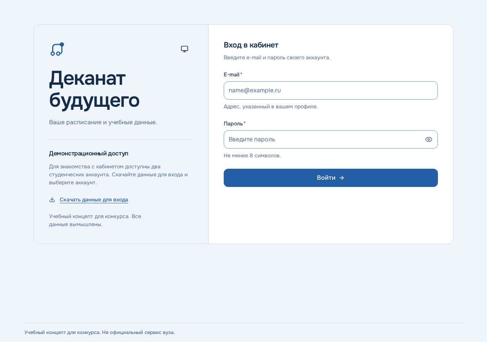

**Профиль.** Академические поля студента.

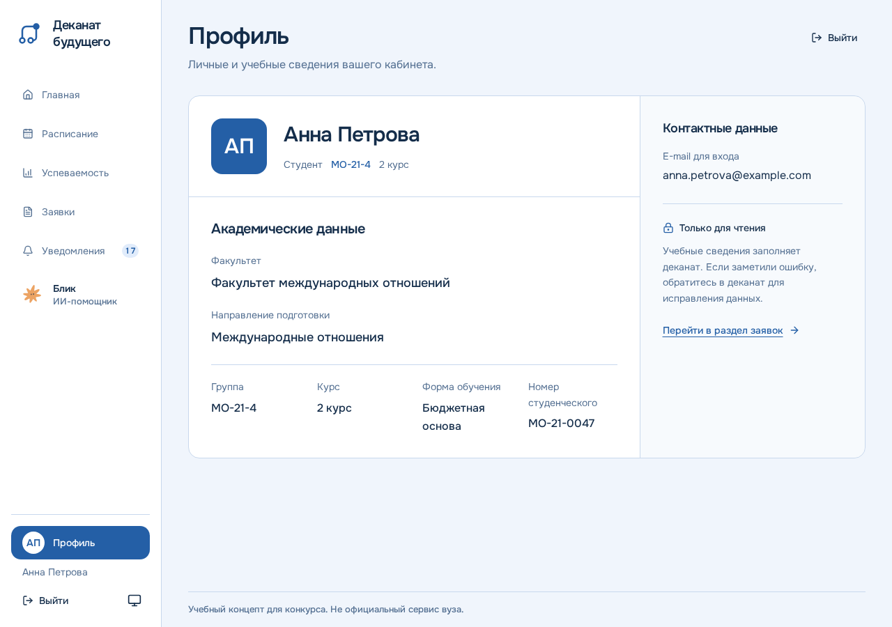

**Расписание «Сегодня».** Текущая пара, изменения и аудитории.

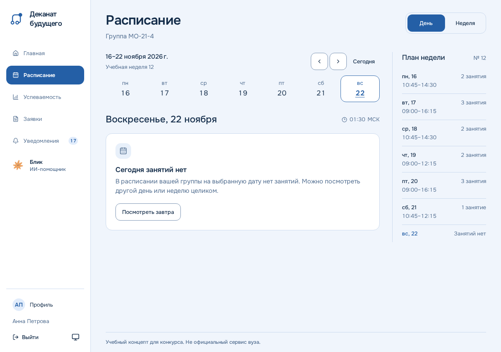

**Расписание «Неделя».** Номер недели, пустые дни и переносы.

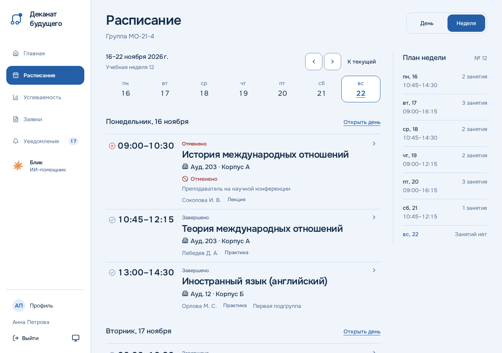

**Успеваемость и сессия.** Сводка, задолженности, даты контроля.

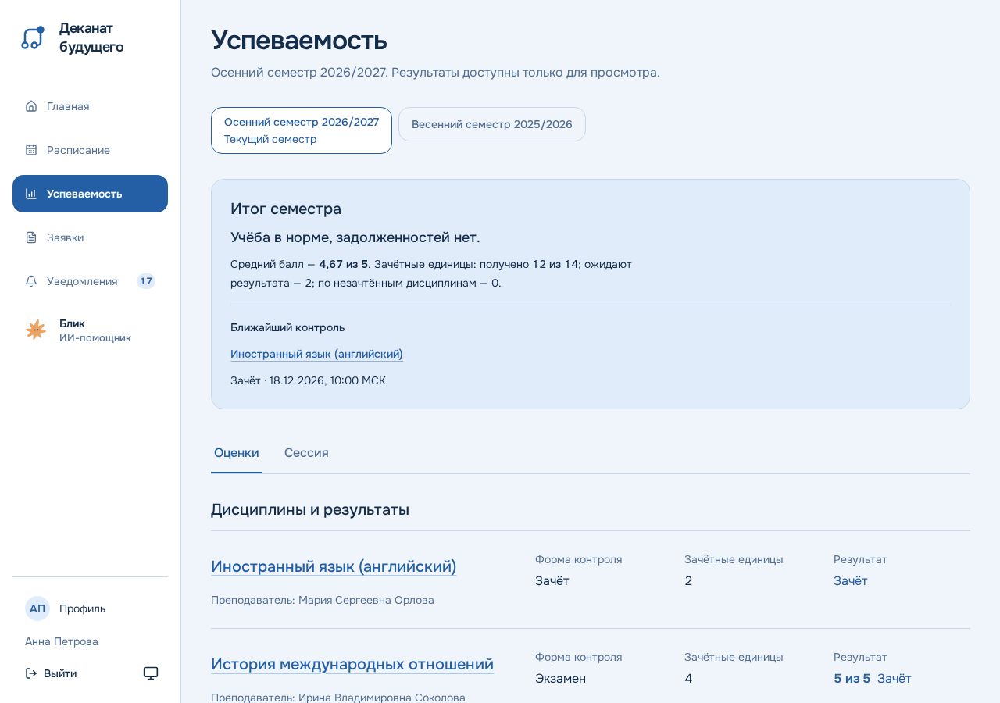

**Создание заявки.** Каталог типов, срок и условные поля.

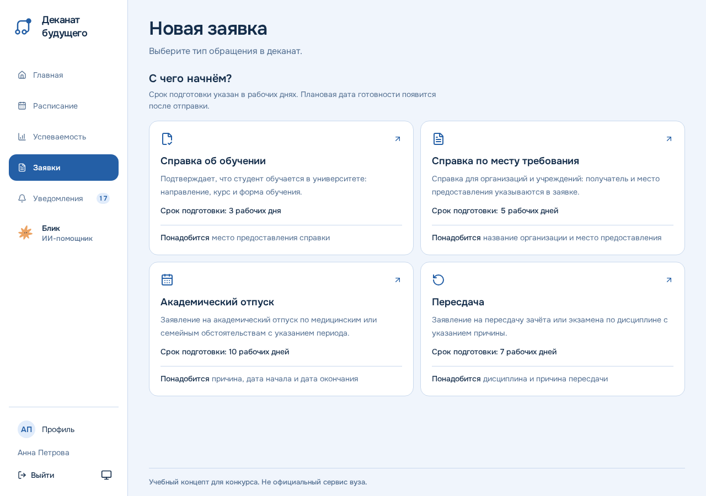

**Мои заявки.** Номер, тип, дата и статус.

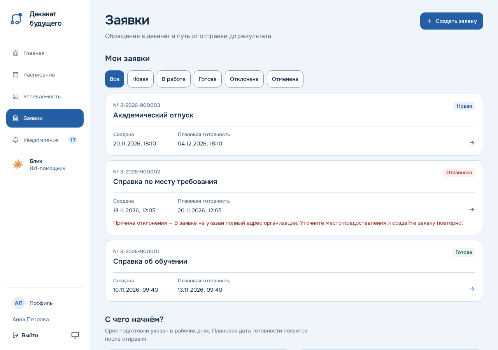

**Карточка заявки.** История статусов и причина решения.

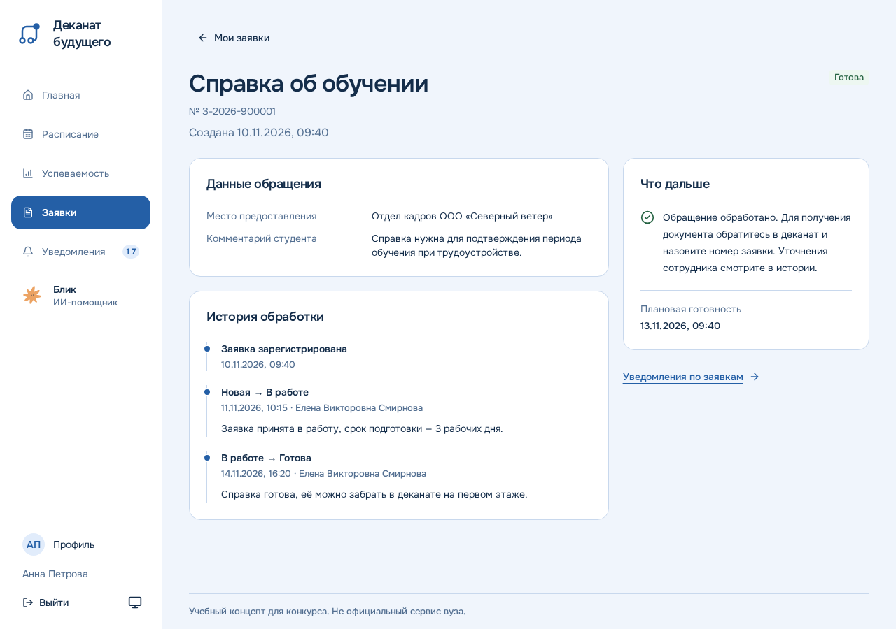

**Уведомления.** Категории, источник и счётчик непрочитанных.

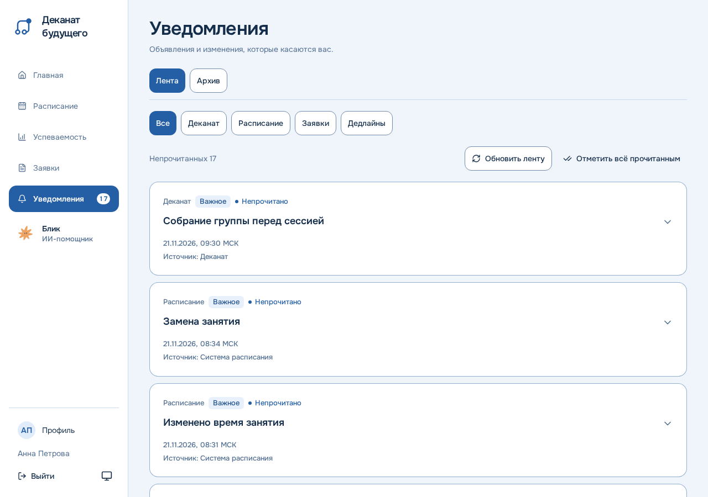

**Главный экран.** Что сегодня и что требует действия.

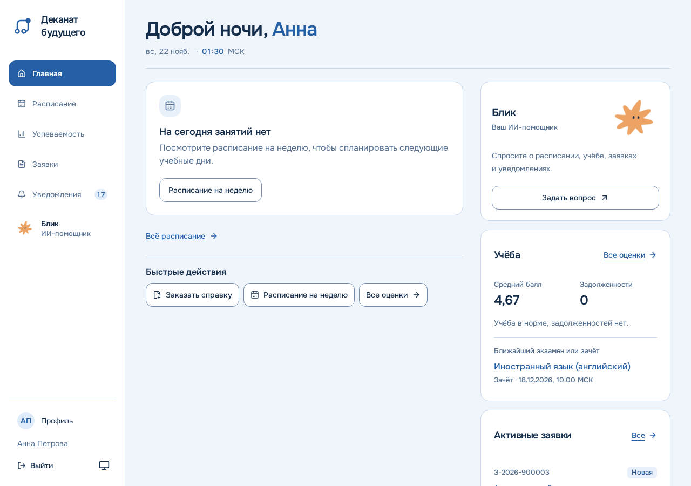

**Кабинет сотрудника.** Очередь заявок и смена статуса.

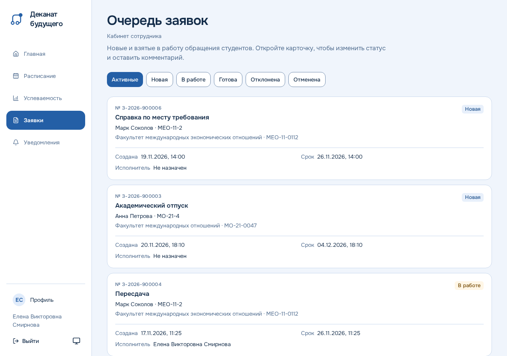

**Мобильная версия, 360 px.** Нижняя навигация без горизонтальной прокрутки.

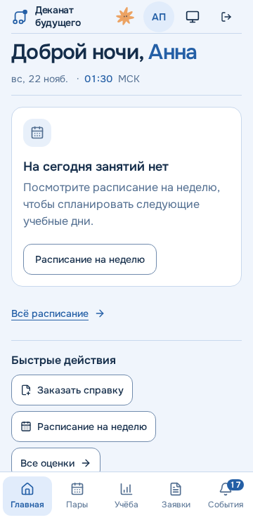

**Проверка безопасности `US-10`.** Анна открывает прямой адрес заявки Марка и получает нейтральный ответ.

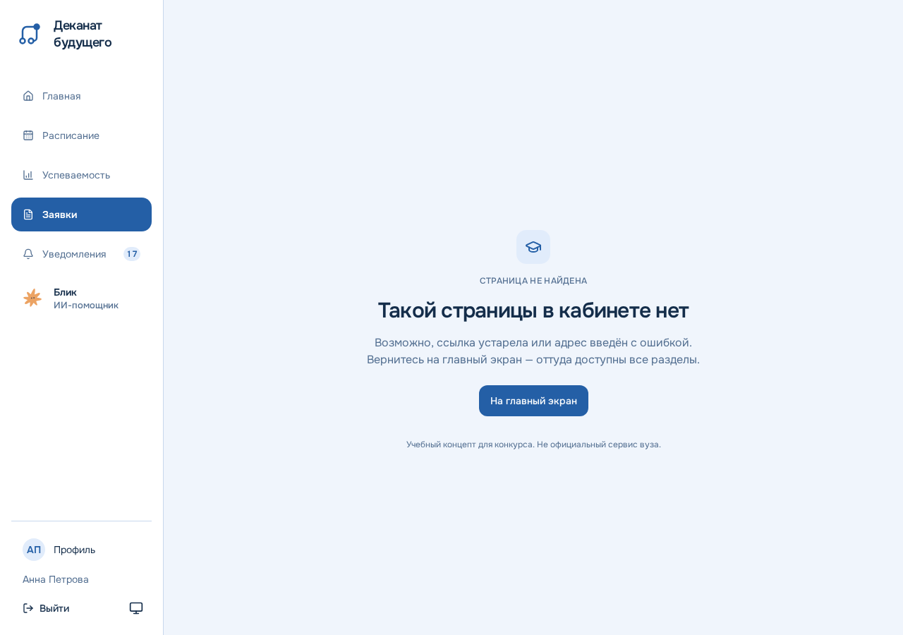

**Восстановление после ошибки.** Искусственный сбой рендера, кнопка «Повторить» и возврат сегмента.

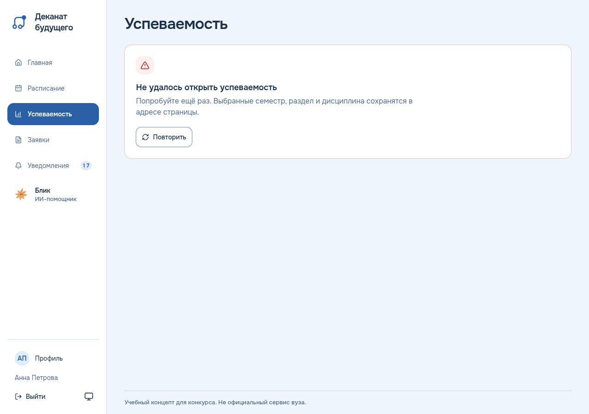

## 14. Ссылки на артефакты

| Артефакт                                               | Что внутри                                                     |
| ------------------------------------------------------ | -------------------------------------------------------------- |
| [`docs/ai-log.md`](../ai-log.md)                       | Полная хронология, промпты, ошибки, метрики, трассировка       |
| [`docs/process/ai-errors.md`](../process/ai-errors.md) | 27 разобранных ошибок и правила, которые из них выведены       |
| [`docs/PRD.md`](../PRD.md)                             | Продуктовое поведение, функции, сценарии, критерии             |
| [`AGENTS.md`](../../AGENTS.md)                         | Инженерные правила, безопасность, проверки, Definition of Done |
| [`docs/DEVELOPMENT_PLAN.md`](../DEVELOPMENT_PLAN.md)   | Этапы, задачи, зависимости и текущий статус                    |
| [`docs/specs/`](../specs/)                             | Процесс SDD, шаблон и спецификации P2–P6, P9                   |
| [`docs/TRACEABILITY.md`](../TRACEABILITY.md)           | Матрица требований, задач, кода и тестов                       |
| [`docs/adr/`](../adr/)                                 | Пять решений: стек, расписание, успеваемость, заявки, ИИ       |
| [`docs/third-party.md`](../third-party.md)             | Лицензии сторонних компонентов                                 |
| [`docs/SUBMISSION.md`](../SUBMISSION.md)               | Чек-лист сдачи и шаблон PDF                                    |
| `README.md`                                            | Запуск, окружение, демо-аккаунты, команды проверок             |

Документ готов к экспорту в PDF; скриншоты вставлены относительными ссылками, поэтому при экспорте сохраняется папка `screenshots/`.
